# Capturas revisadas para o GitHub

Chrome e serviços reais locais, sobre dados sintéticos identificados. Contas de teste, valores comerciais fictícios e fontes sem cobertura presumida.

## Catálogo e cobertura — incremento atual

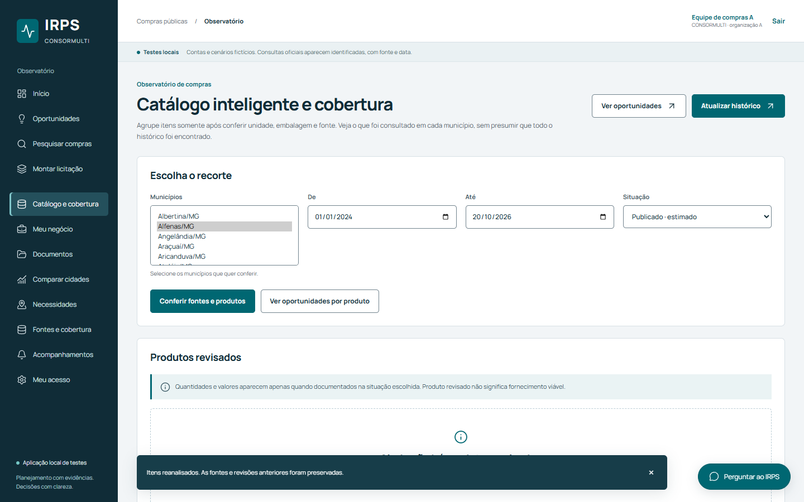

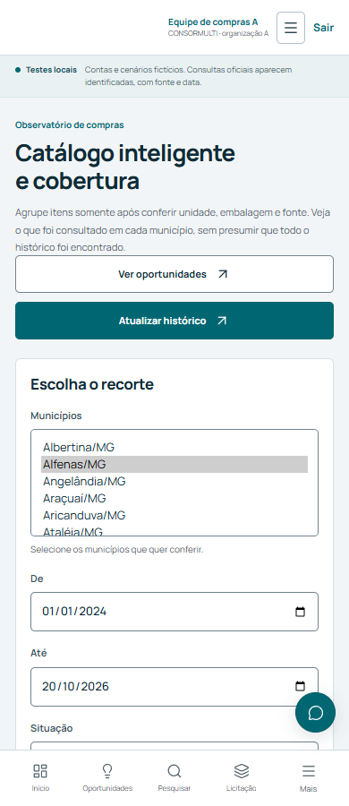

[Capturas completas e critérios de validação](QA_COBERTURA_CATALOGO.md).

## 1440 inicio

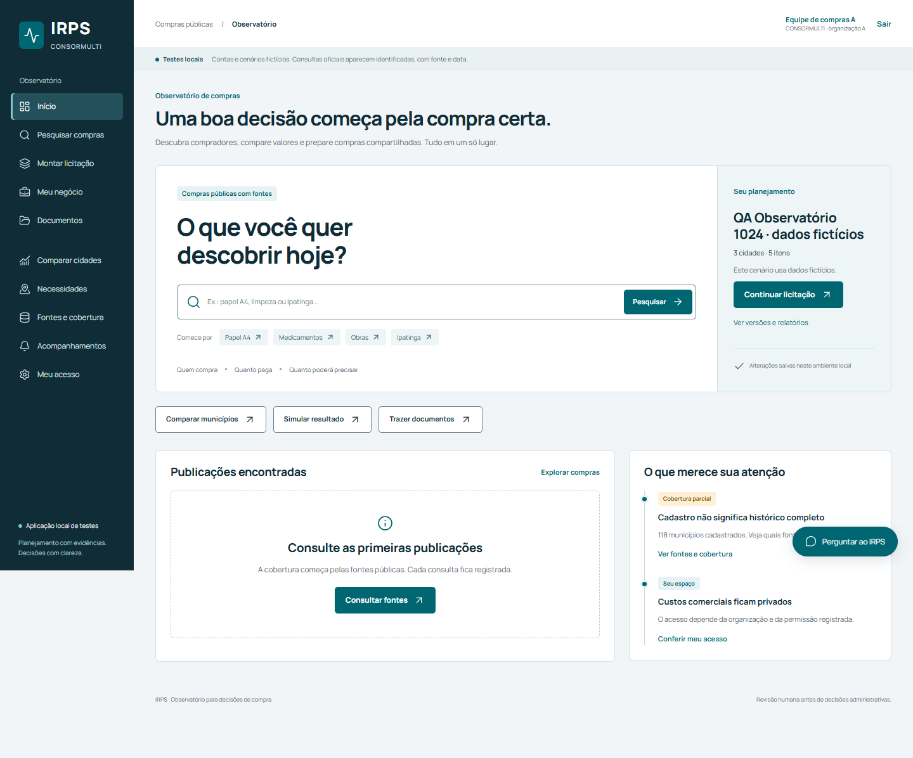

## 390 inicio

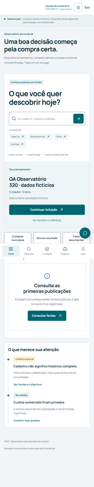

## 1440 licitacao

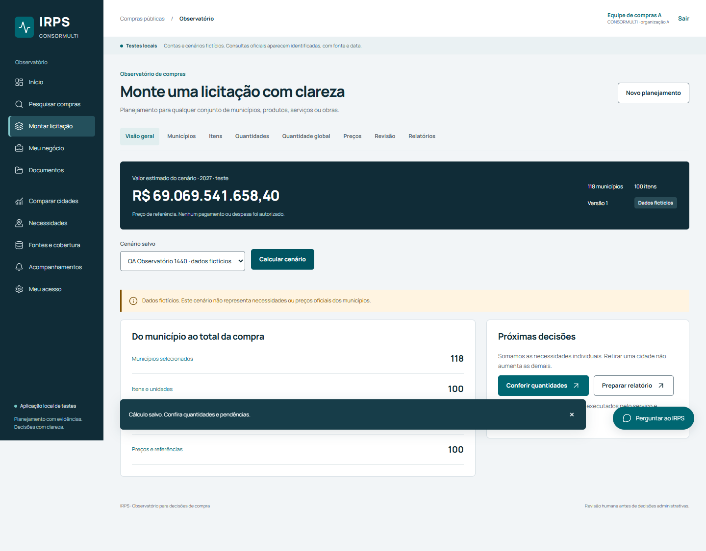

## 390 licitacao

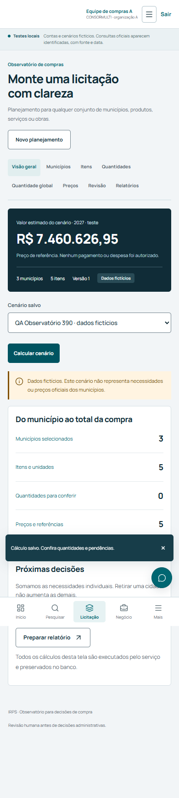

## 1440 quantidades

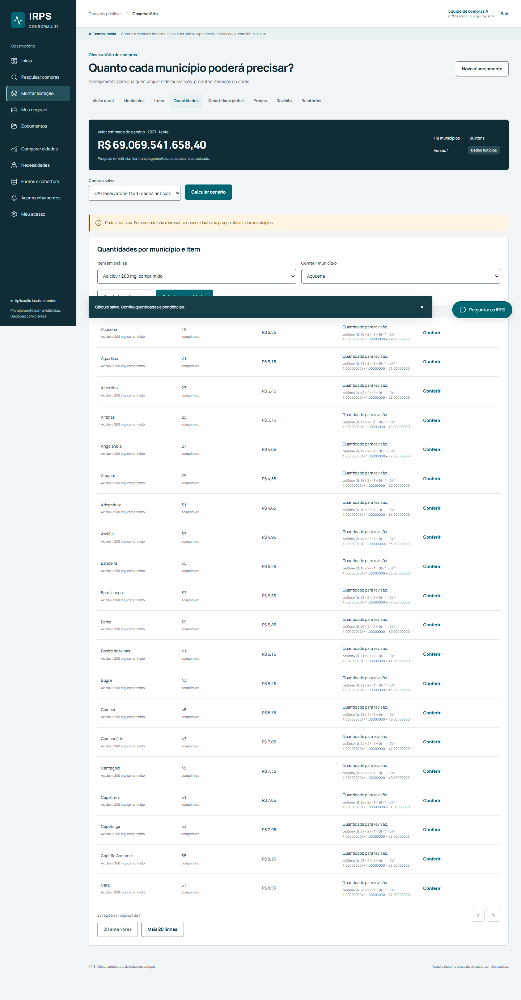

## 390 quantidades

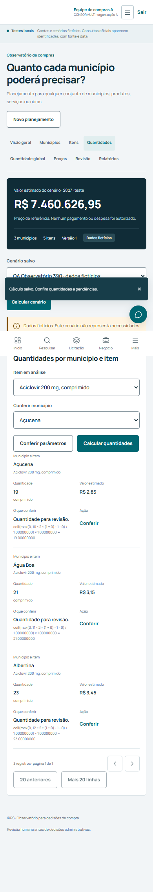

## 1440 negocio

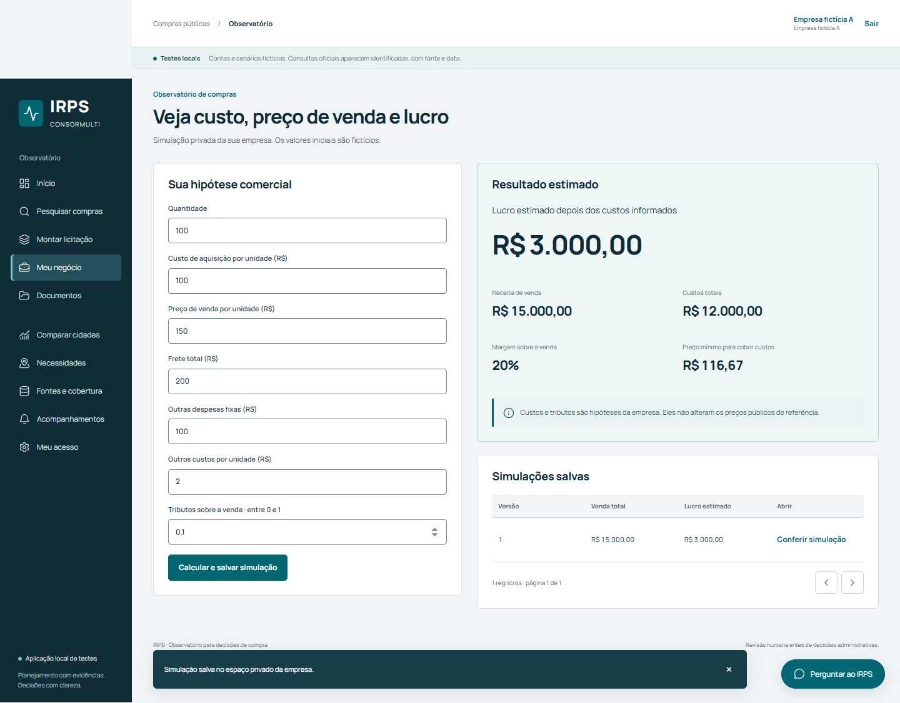

## 1440 documentos

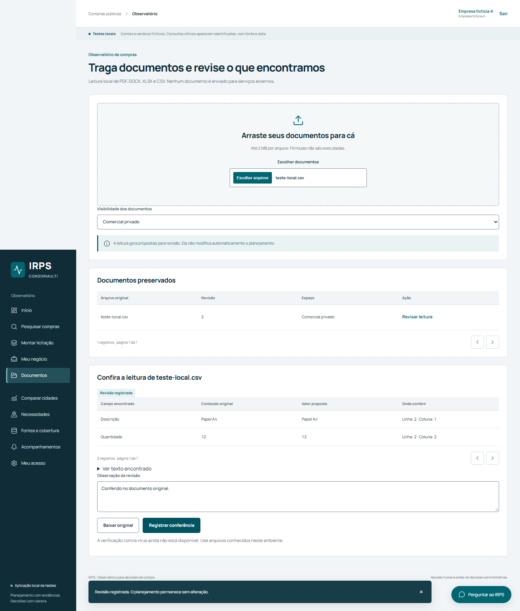

## 390 fontes

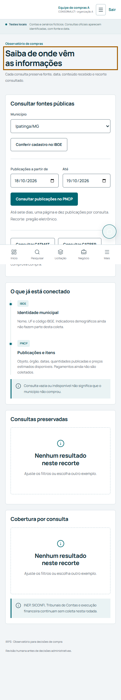

## 390 recuperacao documentos

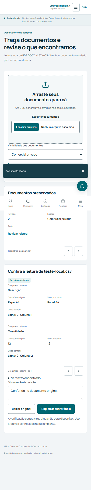

## Oportunidades

As capturas e a jornada verificável da nova área estão em [Resultados de Oportunidades](OPORTUNIDADES_RESULTADOS.md).

