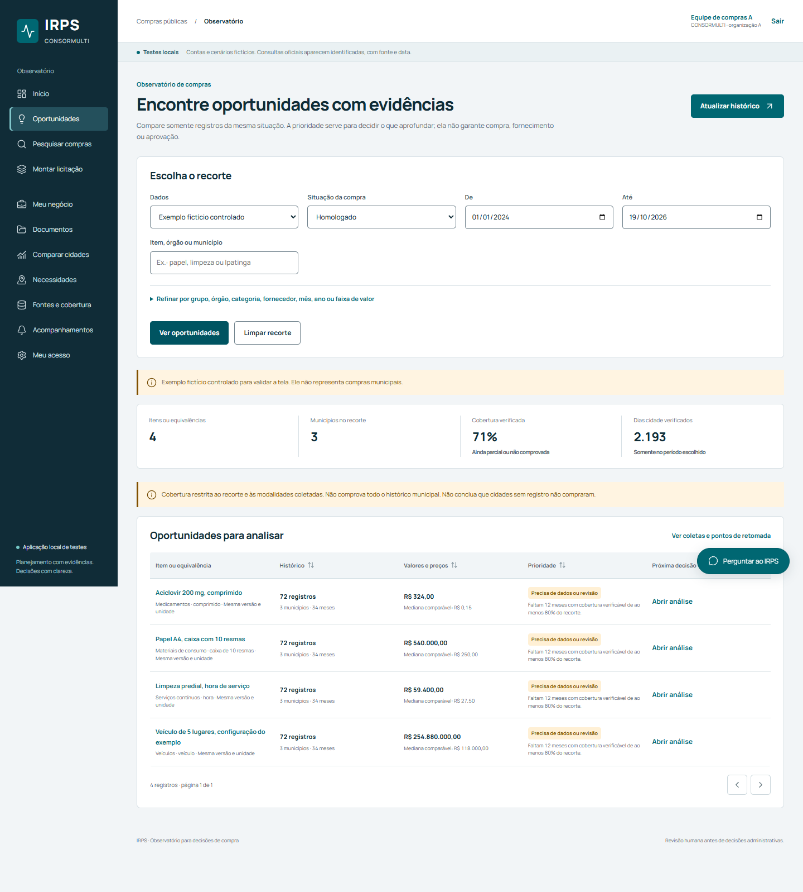
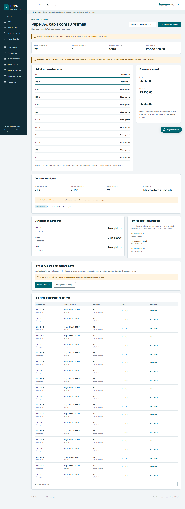
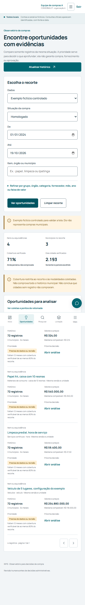

# Resultados — Inteligência de Oportunidades

## Testes executados

| Verificação | Resultado | Evidência |
|---|---|---|
| API de oportunidades, incluindo contexto, fase e sobreposição | 25 aprovados | `backend/tests/test_opportunities.py` |
| Regressão Python completa, incluindo V4 e segurança | 140 casos e 200 subtestes aprovados; 340 entradas JUnit, zero falhas; 55,285 s | [resumo verificável](oportunidades/regressao-pr1.json), `.runtime/evidencias/pytest-pr1-final.xml` |
| Jornada Playwright | 2 aprovados | [metadados](oportunidades/jornada-playwright.json) |
| Playwright completo | 13 aprovados; zero falhas, saltos ou instabilidades; 81,2 s | [resumo verificável](oportunidades/regressao-pr1.json), `.runtime/evidencias/playwright-pr1-final.json` |
| Acessibilidade | Zero violações axe WCAG A/AA nas duas jornadas | Registro Playwright |
| Responsividade | 1440×1050 e 390×844 sem rolagem horizontal indevida | [galeria](#capturas-reais) |
| Build React/TypeScript | Aprovado | `npm.cmd run build` |
| Migrações PostgreSQL | 38 tabelas → zero → 38; 34 com RLS forçada | `scripts/validar_migracoes.py` |
| Revisão humana | Mudança de municípios, período, filtros, versão de fato, equivalência ou cobertura suspende a prioridade; envio antigo recebe 409 | Regressões de API e [detalhe capturado](oportunidades/telas/1440-oportunidade-detalhe.png) |
| Resultados homologados | URL, SHA-256 e consulta do item são expostos; abrangência do período fica indeterminada e não cria meses completos | Regressão com respostas PNCP controladas |
| Grupos equivalentes | Criação conflitante recebe 409; leitura de legado conflitante falha de forma explícita | Regressões de API e função de agrupamento |
| Segredos no índice e histórico | 678 entradas e 265 blobs, zero achados; oito módulos V4 íntegros | `scripts/auditar_publicacao.py --history` |
| Gitleaks no índice | Zero vazamentos encontrados | `gitleaks git --staged` |
| Auditoria de dependências | npm produção e pip: zero vulnerabilidades conhecidas nos pacotes instalados | `.runtime/evidencias/` |

A jornada usou um exemplo fictício controlado, marcado pela interface. Ela
selecionou o conjunto, abriu Papel A4, salvou revisão com evidências fictícias
de teste e criou um rascunho. O arquivo de métricas registra sete cliques,
onze controles alterados (um filtro e dez da revisão humana), quatro telas
percorridas e 7,64 segundos no navegador automatizado. Os controles da
revisão pedem oito textos de evidência e duas decisões de viabilidade;
não foram automatizados porque representam responsabilidade humana.

Durante a correção do PR, uma execução Python concorreu com o validador de
migrações, que recria o mesmo banco de teste, e falhou com tabelas ausentes.
Separados, o validador e os 140 testes passaram. A primeira repetição do
Playwright em uma porta temporária recebeu 403 porque a origem ainda não
estava autorizada. Uma configuração local ignorada pelo Git autorizou somente
essa origem de teste; o login foi conferido e a repetição aprovou 13 testes.
Essas falhas de preparação permanecem nos logs locais. O build emitiu
dois avisos da dependência `lucide-react` sobre `use client`, sem falha de
compilação. O teste Python manteve aviso de depreciação da integração de teste
HTTP; não houve falha funcional final.

## Capturas reais

### Desktop — lista

### Desktop — análise detalhada

### Mobile — lista

## Fonte pública limitada

Em 19/10/2026, uma coleta local consultou o PNCP para o período 13–19/10/2026,
IBGE 3131307 e modalidade 6. Duas páginas retornaram três registros e o limite
configurado encerrou em `limited`; não há alegação de cobertura do município.
Uma coleta separada de contratos, com CNPJ obtido da própria resposta anterior,
retornou um contrato em uma página. O corpo de respostas públicas não foi
incluído no Git; URL, consulta, digest e momento permanecem no banco local.

Detalhes, limites e rotas estão em [OPORTUNIDADES_CONSORMULTI](../implementacao/OPORTUNIDADES_CONSORMULTI.md).
